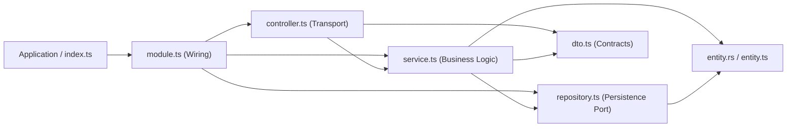

# Architecture Guide

This repository follows a **layered modular monolith** architecture. Every business domain lives in an isolated module with strict, unidirectional dependencies enforced automatically by `tests/architecture.test.ts`.

## Dependency Direction



## Module Structure (`src/modules/<domain>/`)

Every domain module is organized into six single-purpose files (each capped at 500 lines):

1. **`entity.ts`**: Pure domain interfaces and invariants. Must never import `dto`, `repository`, `service`, or `controller`.
2. **`dto.ts`**: Request/response types and boundary validation (`validateAddRequest`). Must never import `repository`, `service`, or `controller`.
3. **`repository.ts`**: Persistence interface (`MathRepository`) and storage adapters (`InMemoryMathRepository`). Imports only `entity.ts`.
4. **`service.ts`**: Core business rules and orchestration. Coordinates `dto.ts`, `entity.ts`, and `repository.ts`. Must never import `controller.ts`.
5. **`controller.ts`**: Transport adapter (HTTP, CLI, RPC). Accepts raw inputs, invokes `service.ts`, and returns `dto.ts`. **Forbidden** from importing `repository.ts` directly.
6. **`module.ts`**: Composition root (`createMathModule()`) that wires `InMemoryMathRepository` into `MathService` and `MathController`.

## Reference Example: `modules/math`

The included `src/modules/math/` module demonstrates this pattern with an addition service that validates safe integers, prevents overflow, and records calculation history.

## Adding a New Domain Module

1. Create `src/modules/<domain>/` with the six standard files (`entity.ts`, `dto.ts`, `repository.ts`, `service.ts`, `controller.ts`, `module.ts`).
2. Re-export the module factory and public types from `src/index.ts`.
3. Add functional unit tests in `tests/unit.test.ts` and layer boundary assertions in `tests/architecture.test.ts`.
4. Run `pnpm validate` to verify all eight gates pass.

## Monorepo Variant Architecture

When scaling beyond a single package into multiple deployable applications or shared libraries, adopt the workspace monorepo layout:

```text
.
├── apps/                         # Independently deployable applications
│   ├── web/                      # Public web app or landing
│   └── api/                      # Backend service or edge worker
├── packages/                     # Shared packages with explicit public exports
│   ├── core/                     # Domain models, invariants, and business logic
│   └── ui/                       # Design tokens, layouts, and UI primitives
├── pnpm-workspace.yaml           # Workspace definition: ["apps/*", "packages/*"]
├── pnpm-lock.yaml                # Single committed lockfile
├── package.json                  # Root orchestration scripts (pnpm -r validate)
└── tsconfig.base.json            # Shared TypeScript compiler options
```

- **Workspace Dependencies**: Declare internal package dependencies via `"@workspace/core": "workspace:*"`.
- **Validation Parity**: Root `pnpm validate` executes across all workspace packages while preserving boundary checks.
